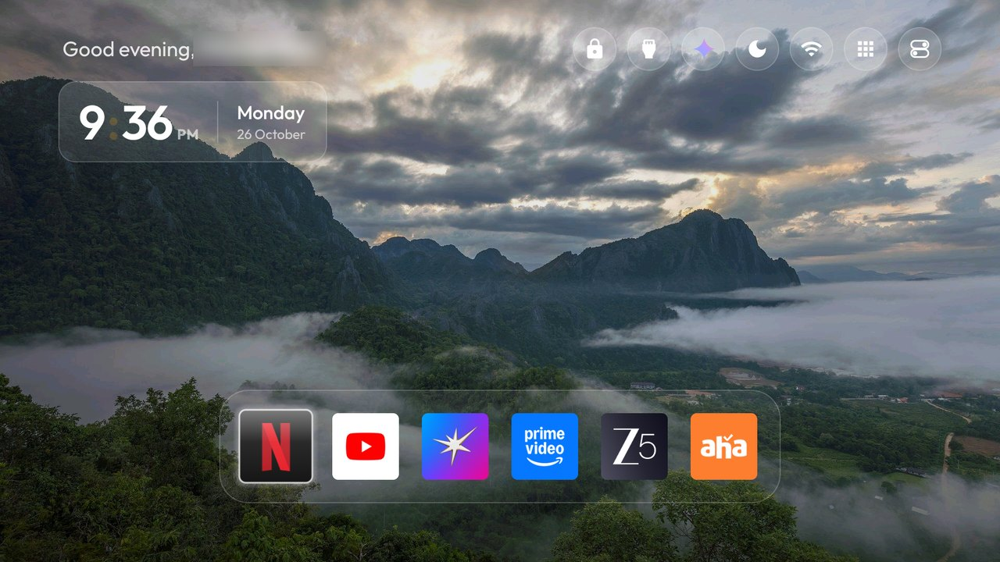
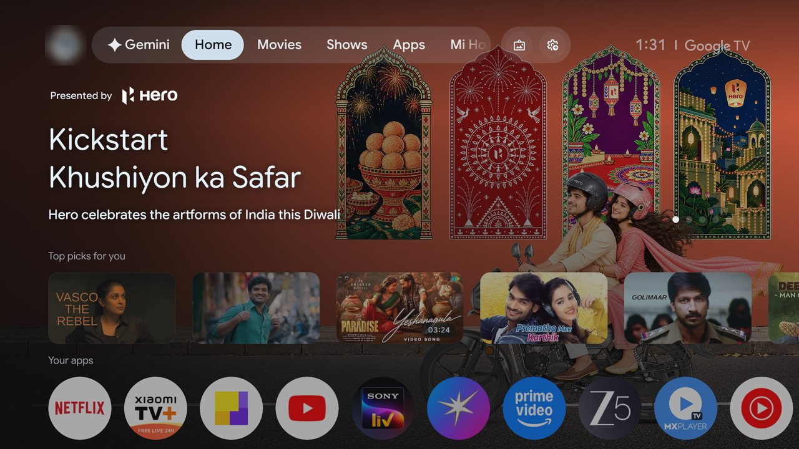
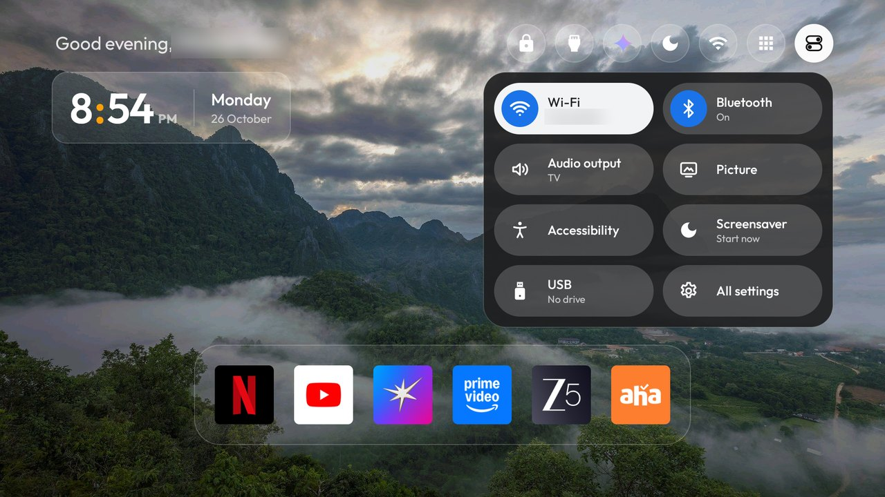
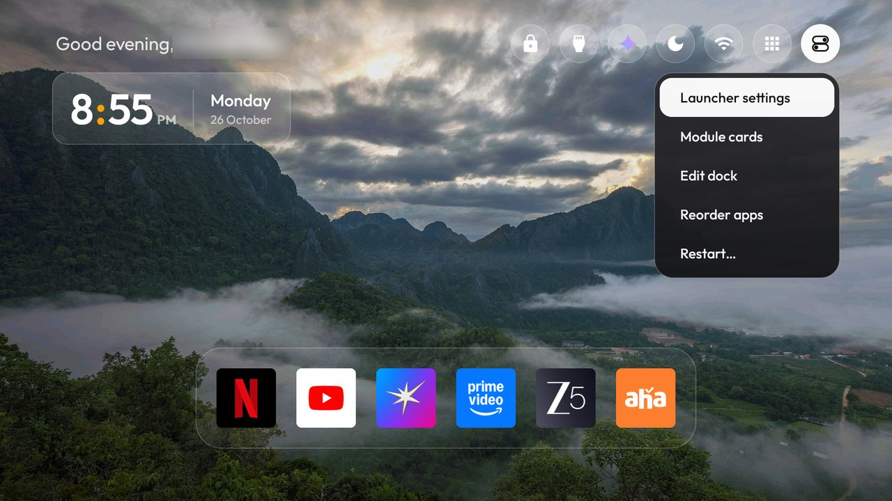
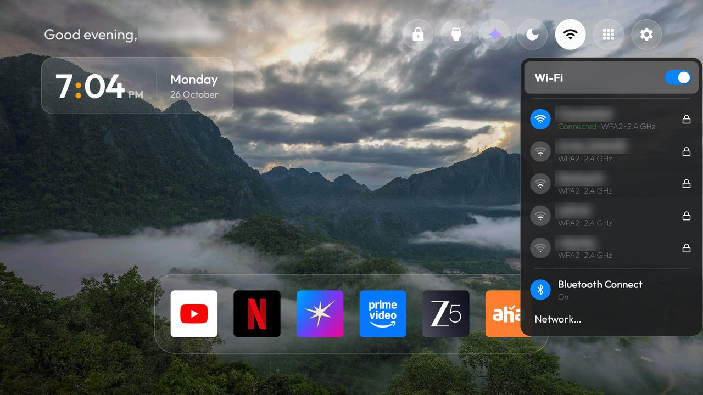
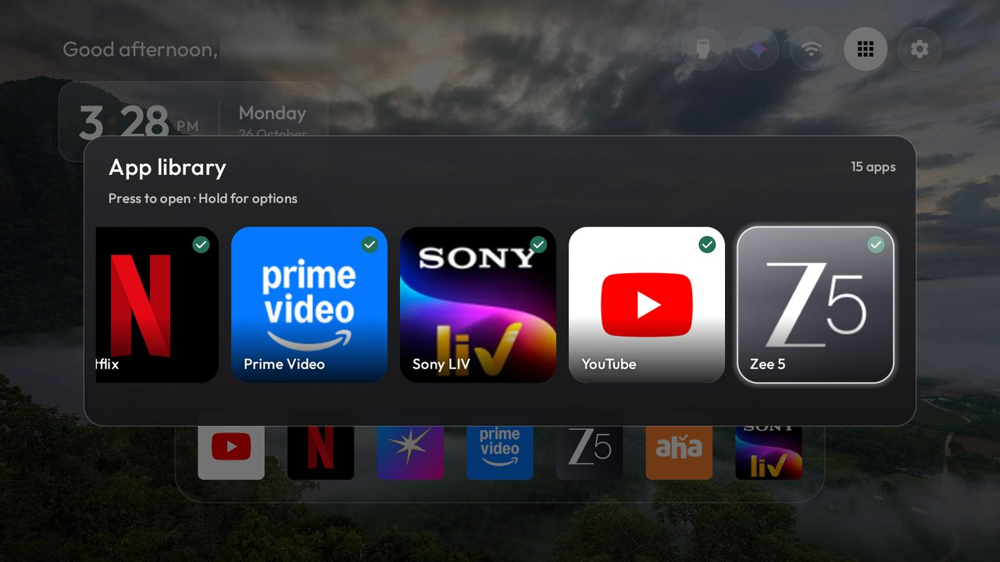
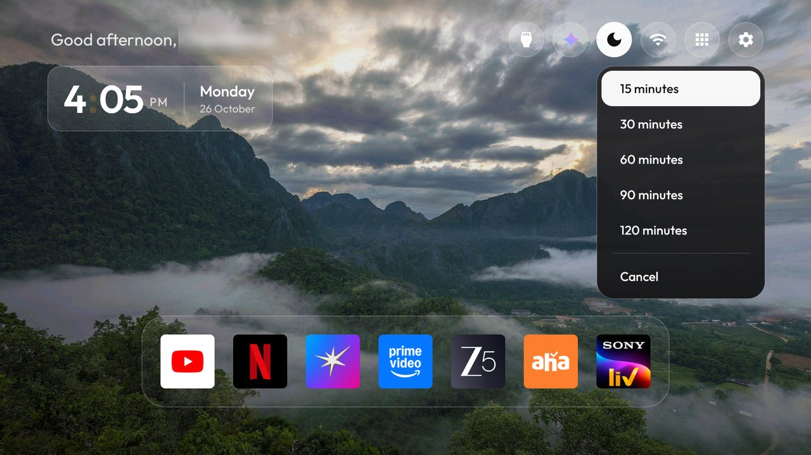
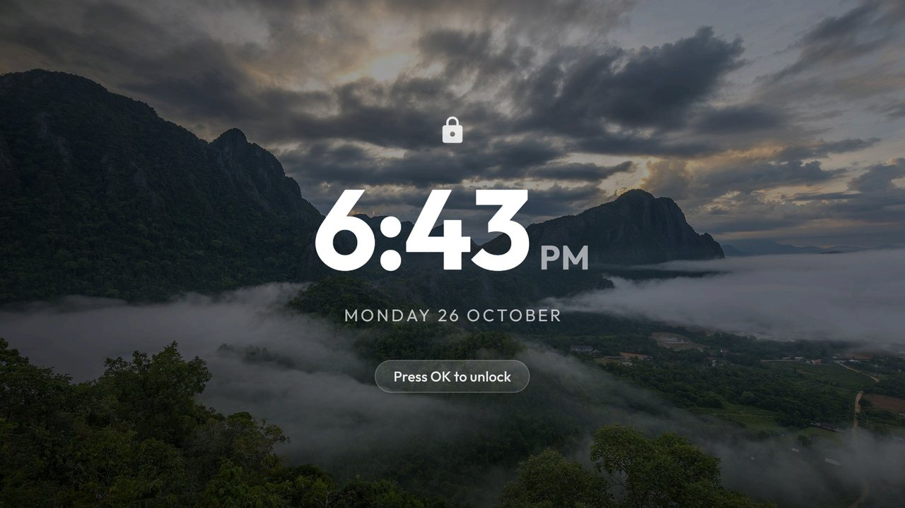

<h1 align="center">An Apple TV–style home for the Xiaomi TV A Pro 2026</h1>

<p align="center">
A clean, ad-free Google TV with a calm, macOS-inspired home screen and a Google TV–style Control Centre.<br>
Built on <a href="https://github.com/Gathin23/cleanyourtv">CleanYourTV</a>: no root, nothing flashed, and every change can be undone.
</p>

<p align="center">


</p>

<p align="center">

</p>

<p align="center">
<a href="#before-and-after">Before and after</a> ·
<a href="#the-home-screen">Home screen</a> ·
<a href="#control-centre">Control Centre</a> ·
<a href="#the-wi-fi-menu">Wi-Fi menu</a> ·
<a href="#more-screens">More screens</a> ·
<a href="#what-was-removed">What was removed</a> ·
<a href="#setup-guide">Setup guide</a> ·
<a href="#undo-everything">Undo</a>
</p>

| | |
|---|---|
| **TV** | Xiaomi TV A Pro 2026, 4K (`MiTV-MZTU0`, MediaTek `mt5896`) |
| **System** | Google TV on Android 14 |
| **Launcher** | `com.gathin.tvhome`, built from [`launcher/`](launcher) in this repo |
| **Theme** | [`themes/apple-tv-clock-card`](themes/apple-tv-clock-card) |
| **Themes** | This one and the original project's; 11 ship in [`themes/`](themes/) |
| **Add-ons** | [Sleep Timer](addons/sleep-timer), [Bluetooth Connect](addons/bluetooth-connect), [Wi-Fi Control](addons/wifi-control) |

## Highlights

- **No ads, no clutter.** Sponsored rows, autoplaying trailers and Xiaomi's ad channels are switched off.
- **A home that feels like Apple TV.** A greeting, a glass clock card, round glass buttons and a centred dock of six apps.
- **A Control Centre** like Google TV's own: Wi-Fi, Bluetooth, audio output, picture, accessibility, the screensaver, USB and all settings, one press away.
- **A macOS-style Wi-Fi menu** that switches Wi-Fi and joins networks without leaving Home.
- **Bedtime and a lock screen:** a sleep timer on the moon button, and a lock that only **OK** opens.
- **Never a black screen:** if the wallpaper isn't ready after power-on, the background glows in the focused app's colour until it is.
- **Light on a 1 GB TV:** no internet permission, no background services, no analytics.
- **Safe:** apps are disabled, never deleted, and one command brings everything back.

---

## Before and after

| Before: Google TV | After |
|---|---|
|  |  |
| Sponsored banners, autoplaying trailers, rows of recommendations and Xiaomi's own ad channels. | One greeting, the time, seven round buttons and the six apps we actually watch. |

---

## The home screen

### Header
- **Greeting** on one line, with the name in bold ("Good evening, **Name**"), level with the top buttons.
- **Clock card**: the time on a frosted-glass card, with a bold clock whose orange colon blinks every second, and the weekday and date beside it.

### Top bar, left to right

| Button | What it does |
|---|---|
| Padlock | Locks the screen: a large centred clock over the wallpaper until **OK** is pressed. |
| Inputs | HDMI and other sources. |
| Gemini | Opens Google's assistant. |
| Moon | Sleep timer and bedtime. |
| Wi-Fi | The macOS-style [Wi-Fi menu](#the-wi-fi-menu). |
| App library | Every app, as square cards. |
| Toggles | The [Control Centre](#control-centre), in place of a Settings button. Hold **OK** on it for [more](#hold-ok-for-more). The remote's own Settings button still opens the TV's settings. |

### Dock
YouTube, Netflix, JioHotstar, Prime Video, ZEE5 and aha, on square glass tiles in a frosted bar, centred.

### Behind the scenes
- **Wallpapers**: 12 calm nature photos, shuffled every 30 minutes and dimmed slightly so text stays readable.
- **Hold OK** on a tile: Move, Remove or App info.
- **Home at every power-on**, instead of the last app.
- **Idle clock** after 10 minutes on Home. With `idle_lock`, the screensaver is the lock screen, its clock held in the centre.
- **A clean start-up**: the dock rises into place with the highlight already on the first app.
- **Wallpaper fallback**: right after power-on the wallpaper can take a moment to become readable. Until then the
  background glows in the focused app's colour, and Home swaps the photo in by itself as soon as it can.

---

## Control Centre



The toggles button at the end of the top bar opens a panel of rounded tiles, after the one on Google TV. The focused tile turns white, and
a tile's badge turns blue while that thing is on.

| Tile | Shows | Opens |
|---|---|---|
| Wi-Fi | The network name, or Off | The [Wi-Fi menu](#the-wi-fi-menu) |
| Bluetooth | On or Off | Bluetooth Connect, to pair headphones and speakers |
| Audio output | Where the sound goes: TV, a Bluetooth speaker or headphones by name, or HDMI ARC | Sound settings |
| Picture | | Picture settings |
| Accessibility | | Accessibility settings |
| Screensaver | Start now | The screensaver, straight away |
| USB | The drive's name, or No drive | The TV's file browser |
| All settings | | The TV's settings |

Back closes the panel. It is the `control_center` switch, on in this theme and off by default.

### Hold OK for more



Holding **OK** on the toggles button opens the launcher's own menu: Launcher settings, Module cards, Edit dock,
Reorder apps and Restart.

---

## The Wi-Fi menu



- **Toggle**: switches Wi-Fi on and off from the menu, with the [Wi-Fi Control](addons/wifi-control) add-on installed.
- **Your network** on a blue badge: "Connected", the security type and the band.
- **The four strongest nearby networks**: signal bars, security and band, and a lock when a password is needed.
- **Joining**: choose a network and a password card opens over the screen. A saved or open network connects straight away.
- **Bluetooth Connect** shows On or Off. **Network…** opens the full network settings.

Android 10 and later only let the Settings app switch Wi-Fi or join networks. The small Wi-Fi Control add-on targets
Android 9, which keeps those abilities, and it only acts when the launcher asks. Without it, the toggle and the network
rows open Wi-Fi settings.

---

## More screens

| App library | Sleep timer |
|---|---|
|  |  |

| Lock screen |
|---|
|  |

---

## What was removed

Everything is **disabled, not uninstalled**, so one command brings any of it back. The lists are in [`my-tv/debloat/`](my-tv/debloat):

| List | Switched off |
|---|---|
| `batch1-telemetry.txt` | Xiaomi analytics, statistics and quality uploader, Google feedback |
| `batch2-ads.txt` | PatchWall, the Mi Home tab, Mi channels, Mi TV+, web content, partner auto-installs, TV Manager |
| `batch3-apps.txt` | Apple TV, YouTube Music, MX Player, Mi Music, Google TV's movies app, Play Games |
| `batch4-setupwraith.txt` | The Google TV setup wizard (only after Wi-Fi is re-joined; see the setup guide) |
| `speedup-1.txt` | Print spooler, calendar sync, health connect, TalkBack and other unused Android extras |
| `speedup-2.txt` | Xiaomi gallery, legal and tool apps, the manual, the old screensavers, SonyLIV |

Kept on purpose: Netflix, Prime Video, JioHotstar, ZEE5, aha, YouTube, casting, voice search, firmware updates,
Live TV, and everything the TV needs: HDMI, the remote, Bluetooth, the keyboard and the Play Store.

---

# Setup guide

Everything below runs from a Mac on the same Wi-Fi as the TV. Replace `<tv ip>` with the TV's address
(Settings → Network & Internet → your network → IP address).

## 1. Prepare the computer (once)

```sh
python3 -m venv tools/venv
tools/venv/bin/pip install -r tools/requirements.txt
brew install openjdk@17                       # Java for building the launcher
export JAVA_HOME=/opt/homebrew/opt/openjdk@17
export ANDROID_HOME=~/Library/Android/sdk      # Android SDK platform 34, build-tools 34.0.0
```

## 2. Turn on debugging on the TV

1. Settings → Device Preferences → **About** → press OK on **Android TV OS build** 7 times.
2. Back → **Developer options** → turn on **USB debugging** and **MiTV ADB debugging** (network ADB on port 5555).
3. Connect: `TV_HOST=<tv ip> tools/tv.py --probe`, then tick **Always allow from this computer** on the TV.

## 3. Back up, then debloat in small batches

```sh
TV_HOST=<tv ip> tools/disable.sh my-tv/debloat/batch1-telemetry.txt
TV_HOST=<tv ip> tools/disable.sh my-tv/debloat/batch2-ads.txt
TV_HOST=<tv ip> tools/disable.sh my-tv/debloat/batch3-apps.txt
TV_HOST=<tv ip> tools/disable.sh my-tv/debloat/speedup-1.txt
TV_HOST=<tv ip> tools/disable.sh my-tv/debloat/speedup-2.txt
```

`tools/disable.sh` keeps its own record of every change in `~/.cleanyourtv/`. Take a screenshot between batches
(`TV_HOST=<tv ip> tools/tv.py --screenshot shots/01.png`) to check Home still works.

> **The Wi-Fi trap.** On this TV the Wi-Fi network saved during first setup belongs to the Google TV setup wizard,
> so disabling the wizard takes the TV off Wi-Fi. Before `batch4`, go to Settings → Network & Internet, **forget**
> the network and **join it again**. Check with `tools/tv.py "dumpsys wifi | grep -o 'cname=[^ ]*'"`: it should
> no longer say `setupwraith`. Then: `TV_HOST=<tv ip> tools/disable.sh my-tv/debloat/batch4-setupwraith.txt`.

## 4. Personalise and install the launcher

Set your name for the greeting in `launcher/app/src/main/res/values/config.xml`:

```xml
<string name="greeting_name" translatable="false">Your name</string>
```

Then build, install and push the theme:

```sh
TV_HOST=<tv ip> STOCK_LAUNCHER=com.google.android.apps.tv.launcherx \
  HOME_KEY_SERVICE=1 RESTORE_KEY_SERVICES=1 launcher/build-and-install.sh
TV_HOST=<tv ip> tools/theme.sh themes/apple-tv-clock-card
```

The install script disables Google TV's launcher only after the new one is confirmed as Home.
`HOME_KEY_SERVICE` and `RESTORE_KEY_SERVICES` keep the remote's Settings button working, since Google TV normally hands
it to the disabled stock launcher. To reinstall later, with the stock launcher already off, use `STOCK_LAUNCHER=none`.

## 5. Add-ons

```sh
TV_HOST=<tv ip> addons/sleep-timer/build-and-install.sh        # the moon button: sleep timer and bedtime
TV_HOST=<tv ip> addons/bluetooth-connect/install.sh            # pair headphones and speakers
TV_HOST=<tv ip> addons/wifi-control/build-and-install.sh       # Wi-Fi toggle and joining from the Wi-Fi menu
```

## 6. Close debugging when finished

Port 5555 is unencrypted, so switch it off again:

1. Developer options → turn off **USB debugging**, **MiTV ADB debugging** and **Wireless debugging**.
2. **Revoke USB debugging authorisations**, then reboot the TV.
3. Check from the computer: `tools/adb-closed.py <tv ip>` must report the port closed.

## Undo everything

```sh
TV_HOST=<tv ip> tools/restore.sh my-tv/debloat/batch4-setupwraith.txt
TV_HOST=<tv ip> tools/restore.sh examples/xiaomi-tv-a-pro-2026/debloat.txt com.google.android.apps.tv.launcherx
TV_HOST=<tv ip> tools/restore.sh my-tv/debloat/batch1-telemetry.txt   # and the same for each other list
TV_HOST=<tv ip> tools/theme.sh --reset
```

---

## Launcher switches added in this build

All are in `launcher/app/src/main/res/values/config.xml` and can also be set in a theme's `config.json`.

| Switch | What it does |
|---|---|
| `clock_card` | One-line greeting with the name in bold; the time and date on a glass card |
| `bold_clock` | Bold clock whose orange colon blinks every second |
| `heavy_clock` | The clock at weight 700 with a small AM/PM on its baseline |
| `analog_clock` | A glass analog clock instead of the digital one |
| `square_tiles` | Square glass dock tiles with each app's logo |
| `assistant_button` | A Gemini button in the top bar |
| `usb_button` | A USB button that opens the given file browser app; a USB tile in the Control Centre when that is on |
| `sleep_timer_button` | A moon button with the sleep timer dropdown |
| `wifi_dropdown` | The macOS-style Wi-Fi menu |
| `control_center` | The Settings button becomes the toggles button and its Control Centre panel |
| `library_square_cards` | Square App library cards with the name over the art |
| `lock_button` | A padlock button that opens the lock screen |
| `idle_lock` | The screensaver locks the screen until OK is pressed, with the clock held in the centre |
| `wallpaper_fallback_glow` | The app-colour glow stands in while the wallpaper can't be shown, and Home retries it |

## FAQ

**Will this break my TV?** Nothing is deleted or flashed. Apps are disabled with Android's own `pm disable-user`, and
the lists keep away from what the TV needs to run: HDMI, the tuner, the remote, Bluetooth, the keyboard and the Play Store.

**Can I go back to Google TV?** Yes: see [Undo everything](#undo-everything). A factory reset also restores it.

**Does the launcher go online?** No. It has no internet permission. Every screen is drawn on the TV.

**Will it work on another TV?** The launcher runs on Android TV 8.0 and later. The debloat lists are for this Xiaomi
model; for other TVs see the tested lists in [CleanYourTV](https://github.com/Gathin23/cleanyourtv).

## Credits

- [CleanYourTV](https://github.com/Gathin23/cleanyourtv) by Gathin: the launcher, tools, add-ons and safety rules this
  build stands on, under the MIT licence ([`LICENSE`](LICENSE)). Its full README, covering every supported TV, is in
  [`UPSTREAM.md`](UPSTREAM.md).
- Wallpapers: photos from Wikimedia Commons under CC BY and CC BY-SA, credited in
  [`themes/apple-tv-clock-card/CREDITS.md`](themes/apple-tv-clock-card/CREDITS.md).
- App names and logos belong to their owners; they appear here only to show the TV in use.
